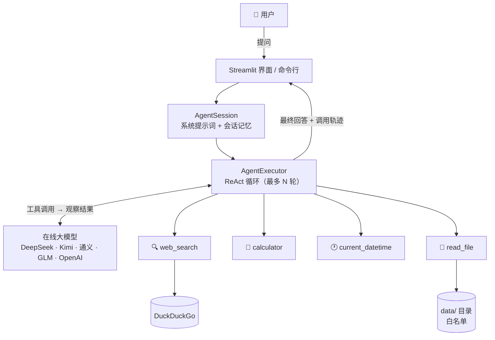
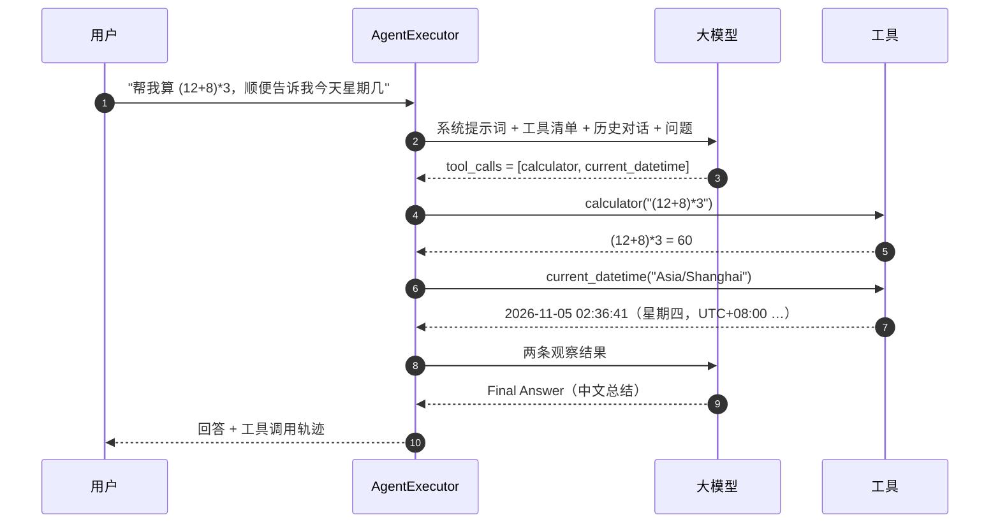

<div align="center">

# 🧠 AgentStudio · 智能体工坊

**基于 LangChain 的工具调用智能体 —— 会搜索、会计算、会看时间、会读文档**

[](https://github.com/chaqiuguan/langchain-agent-studio/actions/workflows/ci.yml)
[](https://www.python.org/)
[](https://python.langchain.com/)
[](https://streamlit.io/)
[](LICENSE)
[](tests)
[](tests)

[项目简介](#-项目简介) · [功能特性](#-功能特性) · [系统架构](#-系统架构) · [快速开始](#-快速开始) · [使用示例](#-使用示例) · [常见问题](#-常见问题)

</div>

---

## 📖 项目简介

**AgentStudio（智能体工坊）** 是一个基于 [LangChain](https://python.langchain.com/) 构建的**工具调用型智能体应用**。

它和"给 ChatGPT 套个网页壳"最大的区别在于：**模型会自己决定该调用哪个工具、调用几次、拿到结果后如何继续推理**。
当你说"帮我算一下 (12+8)*3，顺便告诉我今天星期几"时，它不是硬编码去算、也不是凭记忆猜日期，而是：

1. 分析问题 → 发现要**计算**和**查时间**；
2. 分别调用 `calculator` 与 `current_datetime` 两个工具；
3. 读取工具返回的真实结果；
4. 汇总成中文回答，并把整条调用链展示给你看。

整个过程遵循经典的 **ReAct（Reasoning + Acting）** 循环，由 LangChain 的 `AgentExecutor` 驱动，
最多迭代 `AGENT_MAX_ITERATIONS` 次，避免模型陷入无限调用。

### 适用场景

| 场景 | 用法 |
| --- | --- |
| 📚 **课程 / 资料问答** | 把笔记放进 `data/`，让智能体读完再回答，并给出原文依据 |
| 🔎 **实时信息助手** | 问"LangChain 最新版本是什么"，它会先搜索再总结，并附来源链接 |
| 🧮 **可信计算** | 涉及数字一律走计算器工具，不会出现"大模型算错 7×8"的经典翻车 |

---

## ✨ 功能特性

| 能力 | 说明 |
| --- | --- |
| 🛠 **多工具自主调用** | 内置 4 个工具，Agent 自主决定调用顺序与次数，支持一次并发调多个工具 |
| 🔌 **在线大模型** | DeepSeek / OpenAI / Kimi / 通义千问 / 智谱 GLM / 硅基流动，改一行 `.env` 即可切换 |
| 🏠 **离线模型可选** | 把 `base_url` 指向本地 Ollama（`http://localhost:11434/v1`）即可完全离线运行 |
| 👀 **工具轨迹可视化** | 界面中展开"🔧 工具调用"，能看到每一步的工具名、入参、观察结果与耗时 |
| 🧠 **多轮对话记忆** | 窗口式记忆，保留最近 N 轮，可在界面里实时调整 |
| 🛡 **安全边界** | 计算器走 AST 白名单（不用 `eval`）、文件读取有目录白名单与体积上限、迭代次数封顶 |
| 💻 **双交互形态** | Streamlit Web 界面 + 命令行 REPL，同一套核心代码 |
| 🎭 **零 Key 演示** | 内置 `ScriptedChatModel` 测试替身，没有 API Key、不联网也能演示完整工具调用链路 |
| ✅ **工程化** | 78 个单元测试（全离线）、83% 覆盖率、`ruff` 静态检查、GitHub Actions CI、Dockerfile |

<details>
<summary><b>与"纯聊天机器人"的对比</b>（点击展开）</summary>

| 维度 | 纯聊天应用 | 本项目（智能体） |
| --- | --- | --- |
| 实时信息 | 依赖训练数据，容易编造 | 调用 `web_search`，返回真实链接 |
| 数值计算 | 大模型心算，常出错 | 调用 `calculator`，结果可复现 |
| 当前时间 | 不知道"今天"是几号 | 调用 `current_datetime` 查表 |
| 私有资料 | 无法访问 | 调用 `read_file` 读取 `data/` 内文档 |
| 可观测性 | 只看到最终答案 | 每一步工具调用都可追溯 |

</details>

---

## 🏗 系统架构



### 一次请求的完整链路



**核心代码只有三个文件**：

- `src/agentstudio/agent.py` —— 用 `create_tool_calling_agent` + `AgentExecutor` 装配智能体，管理会话记忆；
- `src/agentstudio/tools/` —— 每个工具一个文件，`tools/__init__.py` 里登记即可生效；
- `src/agentstudio/llm.py` —— 因为所有厂商都兼容 OpenAI 协议，一个 `ChatOpenAI` 就能切换全部服务商。

---

## 🚀 快速开始

### 前置条件

- Python **3.10+**
- 一个大模型 API Key（推荐 [DeepSeek](https://platform.deepseek.com/api_keys)，新用户有免费额度，中文效果好、价格低）

### 1. 克隆并安装

```bash
git clone https://github.com/chaqiuguan/langchain-agent-studio.git
cd langchain-agent-studio

python -m venv .venv
# Windows
.venv\Scripts\activate
# macOS / Linux
source .venv/bin/activate

pip install -r requirements.txt
```

### 2. 配置 API Key

```bash
# Windows
copy .env.example .env
# macOS / Linux
cp .env.example .env
```

编辑 `.env`，最少只需要改这一行：

```ini
LLM_API_KEY=sk-你的密钥
```

> 也可以用各厂商的专属变量，例如 `DEEPSEEK_API_KEY`、`DASHSCOPE_API_KEY`，程序会自动读取。

### 3. 启动

```bash
streamlit run app.py
```

浏览器打开 <http://localhost:8501>，左侧边栏可以切换服务商、模型、温度与启用的工具，中间直接对话。

### 其他入口

```bash
# 命令行交互（安装后才有 agentstudio 命令）
pip install -e .
agentstudio
agentstudio -q "现在北京几点？"

# 或者不安装，直接从源码运行
python -m agentstudio -q "帮我算 sqrt(144)+2**10"

# 没有 API Key 也能体验：脚本化假模型演示工具调用全过程
python demo.py
```

### Docker

```bash
docker build -t agentstudio .
docker run --rm -p 8501:8501 --env-file .env agentstudio
```

---

## ⚙️ 配置项

全部配置都放在 `.env`（模板见 [.env.example](.env.example)），也可以在界面侧边栏临时覆盖。

| 变量 | 默认值 | 说明 |
| --- | --- | --- |
| `LLM_PROVIDER` | `deepseek` | 服务商：`deepseek` `openai` `moonshot` `qwen` `zhipu` `siliconflow` `custom` |
| `LLM_API_KEY` | — | **必填**。通用密钥，优先级高于厂商专属变量 |
| `LLM_MODEL` | 随服务商 | 模型名，如 `deepseek-chat`、`qwen-plus`、`glm-4-flash` |
| `LLM_BASE_URL` | 随服务商 | 接口地址；指向 `http://localhost:11434/v1` 即为本地 Ollama |
| `LLM_TEMPERATURE` | `0.3` | 采样温度，0~2，越低越稳定 |
| `LLM_TIMEOUT` | `60` | 单次请求超时（秒） |
| `AGENT_MAX_ITERATIONS` | `6` | 单轮最多调用工具次数，防止死循环 |
| `AGENT_MEMORY_WINDOW` | `8` | 记忆最近几轮对话，`0` 表示不记忆 |
| `AGENT_MODE` | `tool_calling` | `tool_calling`（推荐）/ `react`（模型不支持函数调用时降级） |
| `AGENT_TOOLS` | 全部 | 启用的工具，逗号分隔 |
| `AGENT_DATA_DIR` | `data` | `read_file` 工具的根目录，**只能读取该目录内文件** |
| `AGENT_VERBOSE` | `false` | 是否把 ReAct 过程打印到终端 |
| `SEARCH_PROVIDER` | `auto` | 搜索后端：`auto`（Bing 优先、ddgs 兜底）/ `bing` / `ddg` |

<details>
<summary><b>各家服务商对照表</b>（点击展开）</summary>

| 服务商 | `LLM_PROVIDER` | 默认模型 | 专属变量 | 申请地址 |
| --- | --- | --- | --- | --- |
| DeepSeek | `deepseek` | `deepseek-chat` | `DEEPSEEK_API_KEY` | <https://platform.deepseek.com/api_keys> |
| OpenAI | `openai` | `gpt-4o-mini` | `OPENAI_API_KEY` | <https://platform.openai.com/api-keys> |
| Moonshot（Kimi） | `moonshot` | `moonshot-v1-8k` | `MOONSHOT_API_KEY` | <https://platform.moonshot.cn/console/api-keys> |
| 阿里云百炼（通义） | `qwen` | `qwen-plus` | `DASHSCOPE_API_KEY` | <https://bailian.console.aliyun.com/> |
| 智谱 GLM | `zhipu` | `glm-4-flash` | `ZHIPUAI_API_KEY` | <https://bigmodel.cn/usercenter/apikeys> |
| 硅基流动 | `siliconflow` | `Qwen/Qwen2.5-7B-Instruct` | `SILICONFLOW_API_KEY` | <https://cloud.siliconflow.cn/account/ak> |

</details>

---

## 🧰 内置工具

| 工具 | 作用 | 示例输入 | 安全设计 |
| --- | --- | --- | --- |
| 🔍 `web_search` | 联网搜索（默认 Bing 网页版，ddgs 兜底），返回标题 / 链接 / 摘要 | `LangChain 最新版本` | 12 秒硬超时 + 连续失败熔断，失败降级为提示而非异常 |
| 🧮 `calculator` | 四则运算、乘方、开方、三角函数、对数 | `(12+8)*3` | **AST 白名单**求值，禁用 `eval`，拒绝导入 / 属性访问 / 字符串 |
| 🕐 `current_datetime` | 查询指定时区的当前时间与星期 | `Asia/Shanghai` | 时区名非法时返回错误文本而非崩溃 |
| 📄 `read_file` | 读取 `data/` 内的文本文件 | `data/开源许可证速查.md` | 目录白名单（防 `../` 与软链接逃逸）、兼容 `data/` 前缀、后缀白名单、200 KB 上限、6000 字符截断 |

### 新增一个工具（3 步）

```python
# 1. src/agentstudio/tools/weather.py
from langchain_core.tools import tool

@tool("get_weather", description="查询城市天气。输入城市名，例如 沈阳。")
def get_weather(city: str) -> str:
    """查询城市天气。"""
    return f"{city}：晴，22℃（示例数据）"

# 2. src/agentstudio/tools/__init__.py 里登记
_TOOL_FACTORIES["get_weather"] = lambda _root: get_weather

# 3. 在 .env 里启用
# AGENT_TOOLS=web_search,calculator,current_datetime,read_file,get_weather
```

模型会自动看到新工具的描述，并按需调用 —— 无需改任何 Agent 代码。

---

## 💬 使用示例

### 示例 1：真实终端输出（零 Key 离线演示）

运行 `python demo.py`，用脚本化假模型走完"调用 → 观察 → 汇总"全流程，
**以下为实际运行输出（可直接复现）**：

```text
──────────────────── AgentStudio 离线演示 · 不需要 API Key ────────────────────
用户：帮我算一下 (12+8)*3 的结果，顺便告诉我今天几号、星期几。

┌──────────────────────────── 第 1 步 · 工具调用 ─────────────────────────────┐
│ calculator                                                                  │
│ 输入：{'expression': '(12+8)*3'}                                            │
│ 输出：(12+8)*3 = 60                                                         │
└─────────────────────────────────────────────────────────────────────────────┘
┌──────────────────────────── 第 2 步 · 工具调用 ─────────────────────────────┐
│ current_datetime                                                            │
│ 输入：{'timezone_name': 'Asia/Shanghai'}                                    │
│ 输出：2026-11-05 02:40:04（星期四，Asia/Shanghai，UTC+08:00，Unix 时间戳    │
│ 1793817604）                                                                │
└─────────────────────────────────────────────────────────────────────────────┘
┌───────────────────────────────── 最终回答 ──────────────────────────────────┐
│ 两件事都办好了：                                                            │
│                                                                             │
│ 1. **计算结果**：`(12+8) = 20`，`20 × 3 = 60`。                             │
│ 2. **今天的日期**：见上一步 current_datetime 的返回值，它同时给出了星期与   │
│ UTC 偏移。                                                                  │
│                                                                             │
│ 说明：本次演示使用的是脚本化假模型 ScriptedChatModel，                      │
│ 它不会真的联网推理，目的是在零成本的情况下展示                              │
│ 「模型发起工具调用 → 工具返回观察结果 → 模型汇总回答」的完整链路。          │
│ 接入真实大模型后，这段回答由模型自己生成。                                  │
└─────────────────────────────────────────────────────────────────────────────┘
耗时 0.01s ｜ 工具调用 2 次
```

### 示例 2：真实大模型输出（DeepSeek 实测）

同一台机器上接入 DeepSeek 的真实运行结果（文件正文已按 600 字符截断，其余为原始输出）：

```text
用户：读一下 data/开源许可证速查.md，用一句话总结 MIT 与 GPL-3.0 的区别
┌────────────────────────────────────── 第 1 步 · 工具调用 ───────────────────────────────────────┐
│ read_file                                                                                       │
│ 输入：{'path': '开源许可证速查.md'}                                                             │
│ 输出：文件 开源许可证速查.md 的内容如下：                                                       │
│ ---                                                                                             │
│ # 开源许可证速查表（课程笔记）                                                                  │
│                                                                                                 │
│ > 本文件是 `read_file` 工具的演示数据：你可以让智能体"读一下这个文件，用一句话总结"。           │
│                                                                                                 │
│ ## 1. 宽松型许可证（Permissive）                                                                │
│                                                                                                 │
│ | 许可证 | 能否商用 | 是否必须开源衍生作品 | 是否保留版权声明 | 典型项目 |                      │
│ | --- | --- | --- | --- | --- |                                                                 │
│ | MIT | 可以 | 不需要 | 需要 | React、Vue、jQuery |                                             │
│ | BSD-2/3-Clause | 可以 | 不需要 | 需要 | Flask、Django（BSD-3） |                              │
│ | Apache-2.0 | 可以 | 不需要 | 需要，且需声明修改 | Kubernetes、Hadoop、TensorFlow |            │
│ | ISC | 可以 | 不需要 | 需要 | npm 生态常见 |                                                   │
│                                                                                                 │
│ **要点**：宽松型许可证允许你把代码放进闭源产品，唯一硬性义务是保留版权与许可声明；              │
│ Apache-2.0 额外提供专利授权条款，并强制标注"文件被修改过"。                                     │
│                                                                                                 │
│ ## 2. 传染型 / 著佐权许可证（Copyleft）                                                         │
│                                                                                                 │
│ | 许可证 | 传染范围 | 分发衍生作品时的义务 | 典型项目 |                                         │
│ | --- | --- | --- | --- |                                                                       │
│ | GPL-2.0 | 整个衍生程序 | 必                                                                   │
│ …（已省略 822 个字符）                                                                          │
└─────────────────────────────────────────────────────────────────────────────────────────────────┘
┌───────────────────────────────────────────── 回答 ──────────────────────────────────────────────┐
│ 一句话总结：MIT 是宽松型许可证，只要求保留版权与许可声明，允许把代码放进闭源产品；GPL-3.0       │
│ 是传染型（著佐权）许可证，一旦分发衍生作品，就必须以 GPL 开源整个衍生程序的源码，并附带反 TiVo  │
│ 化与专利授权条款。                                                                              │
│                                                                                                 │
│ 补充一句选型上的差别：想让代码被尽可能广泛使用（库、SDK、前端组件）选                           │
│ MIT；想让衍生作品回馈社区（编译器、内核模块、桌面软件）选 GPL-3.0。                             │
└─────────────────────────────────────────────────────────────────────────────────────────────────┘
耗时 1.92s ｜ 工具调用 1 次
```
### 示例 3：切换模型服务商

```bash
# 换成通义千问
LLM_PROVIDER=qwen LLM_API_KEY=sk-xxx python -m agentstudio -q "介绍一下你自己"

# 换成完全离线的本地 Ollama（需先 ollama pull qwen2.5:7b）
LLM_PROVIDER=custom LLM_BASE_URL=http://localhost:11434/v1 LLM_MODEL=qwen2.5:7b \
LLM_API_KEY=ollama python -m agentstudio
```

---

## 🗂 目录结构

```text
langchain-agent-studio/
├── app.py                       # Streamlit 界面入口（含配置面板与轨迹渲染）
├── demo.py                      # 零 Key 离线演示入口（python demo.py 即跑）
├── src/agentstudio/
│   ├── config.py                # 配置解析与校验、服务商注册表
│   ├── llm.py                   # 大模型工厂（OpenAI 兼容协议）
│   ├── agent.py                 # AgentExecutor 装配 + 会话记忆 + 结构化返回
│   ├── cli.py                   # 命令行 REPL
│   ├── demo.py                  # 零 Key 离线演示（脚本化假模型）
│   ├── testing.py               # ScriptedChatModel（测试替身，也可用于演示）
│   └── tools/
│       ├── __init__.py          # 工具注册表
│       ├── calculator.py        # AST 白名单安全计算器
│       ├── datetime_tool.py     # 时区时间查询
│       ├── web_search.py        # DuckDuckGo 联网搜索
│       └── file_reader.py       # data/ 目录白名单读取
├── tests/                       # 78 个测试，全部离线、无需 API Key
├── data/开源许可证速查.md         # read_file 的演示数据
├── .github/workflows/ci.yml     # GitHub Actions（ruff + pytest × 3 个 Python 版本）
├── Dockerfile
├── pyproject.toml               # 依赖、ruff、pytest 配置
└── .env.example
```

---

## 🧪 测试与 CI

```bash
pip install -e ".[dev]"
pytest -q                    # 78 个测试
ruff check .                 # 静态检查
pytest --cov=agentstudio     # 覆盖率
```

```text
$ pytest -q
........................................................................ [100%]
78 passed in 3.68s

$ ruff check .
All checks passed!

$ pytest --cov=agentstudio -q
TOTAL      627     106    83%
```

**测试策略**：全部使用 `ScriptedChatModel` 假模型与 `monkeypatch`，**不联网、不需要 API Key**，
因此 CI 里可以稳定跑通。重点覆盖：

- 🧮 计算器的正常表达式，以及 `__import__('os')`、`open()`、`__class__` 等注入攻击必须被拒绝；
- 📄 文件读取的目录逃逸（`../`、绝对路径）必须被拦截；
- 🤖 Agent 的工具调用链路、多轮记忆窗口裁剪、`react` 降级模式、空问题校验；
- 🖥 Streamlit 界面用官方 `AppTest` 无头执行，保证界面代码不回归。

CI 结果见仓库 **Actions** 标签页，徽章在 README 顶部。

---

## 🛡 安全设计

大模型的输出是**不可信输入**，因此本项目在三个位置设了防线：

1. **计算器不碰 `eval`**
   用 `ast.parse` 解析后按白名单递归求值，只允许数值字面量、四则运算与少数 `math` 函数；
   表达式长度、嵌套深度、指数大小、阶乘范围都有上限，防止 `9**999999` 这类内存炸弹。

2. **文件读取有沙箱**
   路径 `resolve()` 后必须位于 `data/` 目录内，`../` 与符号链接逃逸都会被拒绝；
   只允许文本后缀、单文件 200 KB、返回内容截断到 6000 字符。

3. **执行有刹车**
   `max_iterations` 限制单轮工具调用次数，`timeout` 限制单次请求时长，
   工具异常一律转成文本返回给模型，而不是让整个应用崩溃。

4. **密钥不落盘**
   `.env` 在 `.gitignore` 中，`git add .` 不会把它加进去；
   界面里输入的 Key 只存在会话内存，用于当次请求。

---

## ❓ 常见问题

<details>
<summary><b>1. 提示 "缺少 API Key" 怎么办？</b></summary>

按提示操作：`cp .env.example .env`，把 `LLM_API_KEY` 填上；或在左侧边栏直接粘贴。
程序会给出对应厂商的申请地址。
</details>

<details>
<summary><b>2. 换模型后报 "does not support tools" / 工具不生效？</b></summary>

说明该模型不支持函数调用（Function Calling）。把 `.env` 里的 `AGENT_MODE` 改成 `react`，
会退化为纯文本 ReAct 提示词模式，任何对话模型都能用（稳定性略低于函数调用）。
</details>

<details>
<summary><b>3. 联网搜索报错 / 搜不到结果？</b></summary>

`web_search` 默认走 Bing 网页搜索（国内可直连、无需 API Key），失败时自动退回 DuckDuckGo（ddgs）。
单次调用有 12 秒硬超时，连续失败 2 次后熔断，直接返回"暂不可用"提示，避免把一轮回答拖到几分钟。
想强制指定后端，在 `.env` 里设 `SEARCH_PROVIDER=bing` 或 `SEARCH_PROVIDER=ddg`。
</details>

<details>
<summary><b>4. 怎么换成完全离线的本地模型？</b></summary>

安装 [Ollama](https://ollama.com/) 后：

```bash
ollama pull qwen2.5:7b
```

```ini
LLM_PROVIDER=custom
LLM_BASE_URL=http://localhost:11434/v1
LLM_MODEL=qwen2.5:7b
LLM_API_KEY=ollama
```

Ollama 提供 OpenAI 兼容接口，所以不用改一行代码。
</details>

<details>
<summary><b>5. 为什么回答里有时不调用工具？</b></summary>

智能体是"自主决定"是否调用工具。系统提示词里已明确要求"实时信息先搜索、数值计算交给计算器"，
但小参数模型可能偷懒。可以降低 `temperature`、换更强的模型，或在提示词（`config.py` 的
`DEFAULT_SYSTEM_PROMPT`）里把规则写得更强硬。
</details>

<details>
<summary><b>6. 数据会不会被上传？</b></summary>

对话内容会发给你配置的大模型厂商（这是必然的）；`read_file` 读到的文件内容也会作为上下文发给模型。
除此之外没有任何自定义上报。若要完全本地化，请使用第 4 条的 Ollama 方案。
</details>

---

## 🔌 扩展方向

- [ ] 接入 **RAG**：用 `langchain-text-splitters` + FAISS/Chroma 给 `data/` 建向量库，让 `read_file` 升级为语义检索
- [ ] 增加 **代码执行工具**（受限沙箱内）
- [ ] 用 **LangGraph** 重写编排，支持中断、人工审批、多智能体协作
- [ ] 增加 **会话持久化**（SQLite）与 **导出 Markdown**
- [ ] 把工具调用轨迹接入 **LangSmith** 做可观测性分析

---

## 🤝 贡献

欢迎提 Issue 与 PR：

```bash
git checkout -b feat/your-tool
# 改代码 → 补测试 → 本地跑通
pytest -q && ruff check .
git commit -m "feat: 新增 xxx 工具"
git push origin feat/your-tool
```

提交前请确保 `ruff check .` 与 `pytest -q` 都通过。

---

## 📄 开源许可证

本项目基于 [MIT License](LICENSE) 开源，可自由用于学习、二次开发与商业项目，保留版权声明即可。

## 👤 作者

**聂天一** · 东北大学 软件学院 · 开源软件构建技术课程作业

- 仓库：<https://github.com/chaqiuguan/langchain-agent-studio>
- 如果这个项目对你有帮助，欢迎点一个 ⭐ Star

---

<div align="center">
<sub>Built with LangChain · Streamlit · DeepSeek</sub>
</div>
